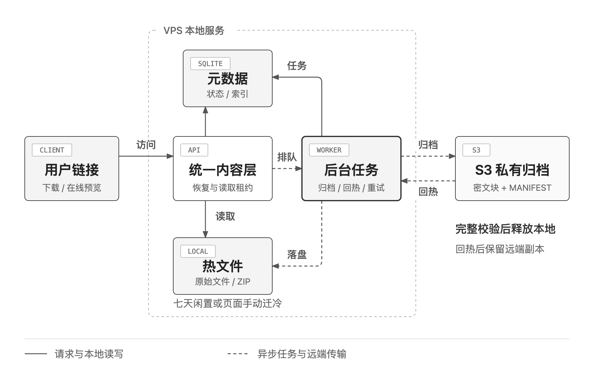
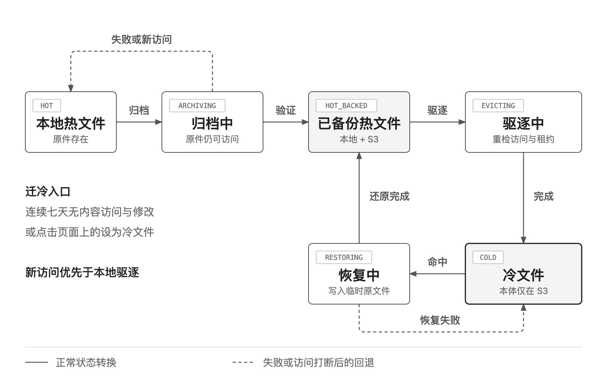
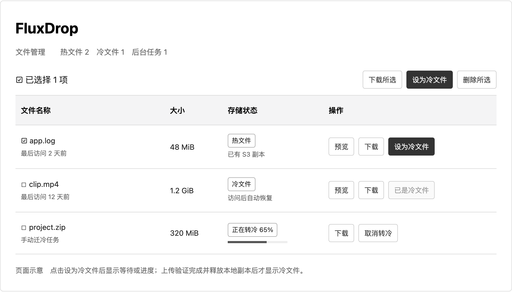

# FluxDrop 冷热存储设计方案

版本 1.1　2026 年 10 月 11 日

采用 S3 保存经过验证的加密归档，VPS 保存原始热文件。文件连续七天无内容访问和修改，或用户在页面主动点击设为冷文件后，进入安全迁冷流程。下载和在线预览命中冷文件时自动恢复，原有分享链接保持可用。



*图 1 统一内容层协调本地热文件与 S3 冷归档*　[查看 HTML 图源](diagrams/cold-storage-architecture.html)

可用性边界：冷文件的本地副本释放后，S3 不可达时下载和预览只能等待或暂时失败。已有热文件继续正常服务。若要求全部冷文件在 S3 长时间故障时仍能读取，需要第二个独立存储副本。

第一版按上传项目完整归档和恢复。目录项目实际是一个 ZIP，访问其中的子文件也会恢复整个 ZIP；目录清单和预览类型常驻元数据。

## 文件状态与自动迁冷规则



*图 2 只有远端归档完整且通过守卫检查，才允许释放本地文件*　[查看 HTML 图源](diagrams/cold-storage-states.html)

冷却时间按最后内容访问、最后内容修改与上传时间中的最新值计算，超过七天才自动迁冷。下载、有效预览和媒体 Range 请求计为内容访问；HEAD、列表刷新、复制链接和无效请求不触发回热。

归档中保留本地原件。恢复中只写临时文件，完整校验并原子发布后才标记为热文件。恢复后保留同版本 S3 副本，再次迁冷可以复用。

驱逐守卫在文件锁内检查任务版本、最新内容访问、活动读取租约、删除或取消标记及远端完整状态。任一条件变化，停止本地删除。删除和归档或恢复并发时，以持久删除标记为准，防止文件复活。

冷却条件采用应用记录的时间戳，不使用文件系统 `atime`：

```text
now - max(last_content_access_at, content_modified_at, created_at) > 7 days
```

## 页面上的手动迁冷入口

文件列表新增存储状态列。每个热文件行展示文字按钮设为冷文件，选择工具栏也提供同名批量按钮；入口保持可见，不只藏在图标或菜单内。



*图 3 页面交互示意 包含行操作 批量操作 冷热状态和任务进度*　[查看 HTML 图源](diagrams/cold-storage-manager.html)

点击只提交一次迁冷意图，立即显示等待转冷或正在转冷，并提供取消。重复点击复用同一个任务；冷文件显示已是冷文件。批量操作逐项提交，分别报告等待、成功或失败。

手动操作仅跳过七天门槛。既有下载和预览继续完成。以文件锁内的最终驱逐提交为分界：此前接受的新内容访问或取消会阻止本地删除；此后访问走冷文件恢复，取消返回已提交或已完成，不再承诺保热。已完成的安全远端副本可以保留。

远端已有同版本完整副本时，检查副本后可直接驱逐，不重复上传。S3 不可用或验证失败则保留热文件，页面显示原因和重试入口。迁冷完成后可通过下载或预览再次回热。

## 归档格式与安全提交

### 分块与密钥

按 32 MiB 原始块切分，每块独立压缩后使用成熟库的认证加密。压缩无收益时存原始块。每个文件版本使用独立数据密钥，每块 nonce 唯一，认证数据绑定文件 ID、版本、块序号和格式。100 MiB 作为最终密文对象上限，包含格式与加密开销，不作为原文件上限。

manifest 记录格式版本、原始大小与 SHA 256、块顺序与原始偏移、对象位置、校验码、压缩方式、nonce、包装后的数据密钥和密钥版本，并进行完整性保护。主密钥独立于 AWS 凭据，在 VPS 外备份。

### 迁冷提交

冻结文件版本并保留本地原件，逐块压缩加密上传，再提交该版本的 manifest。首次发布归档采用逐块回读，验证密文校验码、认证解密、解压长度及完整原文件哈希；验证可流式进行，无需再落盘一个完整原文件。只有验证通过并持久记录 remote_verified，才进入本地驱逐。回读验证会增加传输量和迁冷耗时。

归档采用不可变版本路径，重试复用相同密文或生成新归档版本，避免 nonce 复用。HEAD 只能确认对象元数据和可达性；ETag 不能普遍当作整个文件的 MD5。它们不能替代完整恢复验证。

### 回热提交与重启对账

先预约完整原始大小与安全余量，再逐块下载、验证、解密、解压到同一文件系统内的临时原文件。校验完整长度与哈希后同步文件、原子重命名、同步目录，再提交热状态。失败时保留已验证进度并保持冷状态。

SQLite、S3 和文件系统不共享事务。需要持久化阶段记录、任务租约和版本检查，重启时核对文件、manifest 和任务进度。网络调用不占用长时间数据库事务。远端密文对象保留到用户删除或明确的归档保留策略到期。

## 故障处理与容量控制

| 故障或约束 | 系统处理 |
| --- | --- |
| 上传或 manifest 提交失败 | 保留本地原件；按块续传，指数退避并加入随机抖动。 |
| S3 长时间不可达 | 暂停迁冷和驱逐，限制回热任务；热文件继续服务，冷文件显示暂不可用和重试。 |
| 凭据失效或权限错误 | 停止无效重试并报告配置故障；本地文件不受影响。 |
| 块缺失 校验或解密失败 | 停止恢复并标记归档异常；不发布残缺文件，不误报普通 404。 |
| 容量不足或并发任务 | 预约原始文件空间，避免额度超卖；排队或返回 507，不删除未验证文件。 |
| 进程中断或删除并发 | 启动对账并续作；删除墓碑优先，阻止旧任务重新发布文件。 |

可分配空间等于实际剩余空间，减去系统保留空间和任务尚未落盘的剩余预约字节，避免写盘后重复扣减；未知长度上传增量预约。目录转换计入同时存在的输入、输出与请求临时文件。归档与恢复先各限制一个任务，用户恢复优先。不得把 unlink 后尚被读取的磁盘空间算作已经释放。

七天控制正常冷却；容量水位触发提前回收时，只选择远端完整且当前无人读取的热文件。单文件大于可用热存储容量时，第一版无法完整回热，需限制文件大小或排队失败；后续再扩展按块缓存和流式读取。

网页先展示恢复状态，完成后再加载图片、PDF 或媒体地址。公开下载链接有界等待，超时返回 503 和 Retry-After；只有完成还原后才发送成功文件响应。批量下载需要恢复预算，超额时明确分批，避免生成残缺 ZIP。

第一版使用 S3 Standard 与 SDK 鉴权直连，私有归档不经自定义静态域名。监控本地剩余与预约空间、任务队列、恢复耗时、重试和失败率、异常归档及待清理对象。S3 故障和磁盘压力同时发生时限制新上传。

## 项目改造与实施顺序

| 改造范围 | 设计要求 |
| --- | --- |
| 元数据与任务 | SQLite 保存访问时间、存储状态、文件版本、远端完整标记、manifest、任务租约、重试和删除标记。 |
| 统一读取层 | 普通下载、预览、目录子文件和批量下载共同使用恢复、容量预约与读取租约。 |
| 列表与目录索引 | 冷文件仍出现在列表；预览类型和目录索引常驻，浏览列表和目录不触发整包恢复。 |
| 管理页面与接口 | 展示冷热状态、手动迁冷及批量入口、进度、取消和重试。管理写操作沿用现有可选令牌权限。 |

建议新增的管理接口包括 POST /api/files/FILE_ID/cold 提交手动迁冷，GET /api/files/FILE_ID/storage 返回状态与进度，以及 POST /api/storage-jobs/JOB_ID/cancel 取消任务。提交返回 202 和任务 ID，仅表示已接收；前端持续查询到完成或失败。接口名称为实施建议。

项目入口：app.py 的 StoredFile 与 save_metadata 承担元数据；open_stored_content 是普通下载与预览的接入点；send_bulk_download、send_file_list、send_directory_list 和 do_DELETE 也必须同步改造。前端 file-preview.mjs 需先等待恢复完成再设置媒体地址。

实现需引入 AWS SDK 和成熟加密库，并更新 Dockerfile。配置边界包括 region、endpoint、bucket、凭据来源、加密 key_id 与主密钥路径、闲置天数、分块及密文上限、磁盘保留和超时；密钥不写入前端或源码。

### 实施顺序

1. 固化迁冷规则、分块加密格式和 manifest 版本，迁移元数据并补齐历史记录。
2. 建立统一内容层、文件级任务合并、读取租约与磁盘空间预约。
3. 完成归档及完整恢复验证，先上传归档但保留所有本地原件。
4. 完成回热、重试、熔断、取消、删除墓碑和启动对账。
5. 接入页面状态、手动与批量迁冷入口、进度、取消和重试。
6. 从少量文件驱逐开始，故障验收通过后启用七天自动规则。

冷热存储不自动等于备份。若要防 VPS 损坏，可在上传完成后立即异步归档，七天只控制本地副本释放。新旧加密主密钥和元数据备份都应验证恢复流程。

## 验收要求与参考资料

1. 归档各阶段断网或重启，本地原件完整可读；未验证归档绝不触发本地删除。
2. 缺块、篡改、错误密钥或哈希不符，拒绝发布恢复文件并报告归档异常。
3. 多个下载和预览命中同一冷文件只创建一个任务；普通下载、Range、目录子文件与批量下载均经过恢复层。
4. 手动按钮和批量入口可见；重复提交幂等，取消在重启后仍生效，批量逐项展示结果。
5. 手动迁冷期间的新下载或预览取消本次驱逐，既有读取内容完整；最终驱逐与取消之间无竞态。
6. 已验证同版本 S3 副本可复用且无需重复上传；远端检查失败保留热文件并显示重试。
7. 并发上传和恢复不超卖空间；超大文件、批量超额、S3 长期不可达有明确等待或失败提示。
8. 归档、恢复、取消和删除各提交点强制中断后可对账；已删除文件不会被后台任务复活。

### 参考资料

- [AWS S3 一致性与单对象原子更新](https://docs.aws.amazon.com/AmazonS3/latest/userguide/Welcome.html#ConsistencyModel)
- [AWS S3 上传与完整性校验](https://docs.aws.amazon.com/AmazonS3/latest/userguide/checking-object-integrity-upload.html)
- [AWS HeadObject 返回对象元数据](https://docs.aws.amazon.com/AmazonS3/latest/API/API_HeadObject.html)
- [AWS 客户端信封加密](https://docs.aws.amazon.com/amazon-s3-encryption-client/latest/developerguide/how-it-works.html)
- [AWS SDK 重试机制](https://docs.aws.amazon.com/sdkref/latest/guide/feature-retry-behavior.html)
- [AWS S3 存储类别](https://docs.aws.amazon.com/AmazonS3/latest/userguide/storage-class-intro.html)

图形由 Diagram Design 工作流绘制，采用 FluxDrop 现有界面的黑白配色与系统字体。项目代码依据当前 app.py、static/app.css 与 static/file-preview.mjs。文档不包含 AWS 访问密钥；部署时使用轮换后的凭据和独立的加密主密钥。

## 第一版范围

设计已接入服务端和实际管理页面，默认关闭。实现入口是 `fluxdrop_storage.py`，由 `app.py` 统一接入下载、预览、目录内容、批量下载、上传空间预算和删除；页面保留原有简洁布局，冷热状态与进度使用少量低饱和颜色点缀。

页面包含行操作与批量「设为冷文件」、状态、进度、取消和重试。新增公开 `POST /api/files/FILE_ID/restore` 为网页预览和下载预先恢复文件；`GET /api/files/FILE_ID/storage` 只查询状态。手动迁冷和取消沿用管理令牌，过晚取消返回 409。

行内状态标记以暖金表示热文件、灰蓝表示冷文件，紧凑图标加文字的手动转冷入口紧邻状态；下载、预览、复制和删除保留一排图标。热转冷进度从暖色过渡到冷色，回热方向相反；颜色仅作辅助，状态文字与可访问性标签继续准确表达任务结果。线上更新先提交并推送 Git，再在 VPS 快进拉取和重建服务。

部署配置、主密钥生成与备份要求见 [README](../README.md#冷热存储) 和 [环境变量模板](../.env.example)。启用前需配置私有 S3、轮换后的访问凭据和独立加密主密钥；仓库未保存访问密钥。自动测试使用内存远端模拟正常 S3、断连与损坏，不连接真实 AWS bucket。2026 年 10 月 11 日经 SSH 只读核查线上：110 个冷文件均有完整校验记录、本地副本已释放，112 次迁冷和 2 次恢复任务已完成，无失败记录。

实施验证：188 项 Python 测试和 73 项前端测试通过，覆盖断连、篡改、空间不足、恢复续传、取消与删除、重启对账和跨进程锁。Docker Compose 配置校验、镜像构建和断网启动通过；Chromium 桌面与手机检查通过，保持原页面风格且无横向溢出。

进度显示区分排队、准备、上传、回读校验、转冷和恢复；百分比按已完成的原始块更新。小文件可在两次查询之间直接完成，等待期间显示活动动画，服务端确认完成后平滑填满并停留约 800 毫秒，再收起。动画不延迟真实状态和操作按钮更新，并尊重系统减少动态效果设置。服务端已受理任务持久化在 SQLite，刷新或关闭页面不取消任务；重新打开时读取原任务 ID、状态和进度。前端有界并发查询，并隔离旧查询和写入操作，防止迟到的响应将完成或取消状态覆盖回排队。
